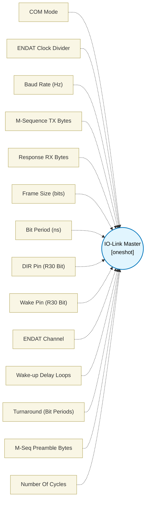

# IO-Link Master (`iolink_master_block`) — Design Document

> Generated by `build_block_docs.js` from `.metadata/sysconfig/.meta/pru_blocks/application_specific/iolink_master_block.syscfg.js`. Do not edit by hand; re-run `node build_block_docs.js`.

## Purpose

IO-Link master PHY engine that runs a complete master -> device
transaction cycle on the C/Q half-duplex line.

**Protocol flow per transaction:**
  1. Wake-up pulse: C/Q driven low for >=80 us, then released high.
  2. M-sequence TX: Master transmits N bytes (1..8), one 11-bit 8E1 character each, via ENDAT hardware.
  3. Turnaround: C/Q released; master listens for >=4 bit periods.
  4. Response RX: Device replies with M bytes (0..4), one 11-bit 8E1 character each, via ENDAT hardware.
  5. Idle: C/Q high.

**Peripheral resources:**
- ENDAT channel (1 of 3 per PRU) for hardware UART TX/RX framing.
- 1x R30 GPIO for transceiver direction control (DIR).
- 1x R30 GPIO for wake-up pulse drive.
- No IEP, MAC, or SPAD required.

**Supported COM rates:**
  COM1 = 4.8 kbps  (divider 39999, frame 11 bits)
  COM2 = 38.4 kbps (divider  4999, frame 11 bits)
  COM3 = 230.4 kbps(divider   832, frame 11 bits)

**BOM:** Requires an external IO-Link transceiver (e.g. TI OL1013, MAX14819)
to convert the PRU's 3.3V ENDAT UART to 24V C/Q levels.

**Status:** metadata only. The ENDAT programming follows the UART blocks
(`uart_config`, `uart_tx_op`, `uart_rx_op`), but the in-tool simulator does
NOT model the internal ENDAT FIFO/TX/RX state machine, so the transaction
is not simulated in the tool; only the R30 wake-up/DIR waveform is checked.
The TI pru-simulator's peripheral-interface model runs the transmit and receive paths.
The transmit path sends up to 8 bytes (two 32-bit inputs), one character per byte, each character
started by its own TX GO.

**Outputs:** output1 = response bytes, first received byte most significant (up to 4 bytes).
output2 = receive status: bit 0 = parity error, bit 1 = framing error (start or stop bit), 0 = all
characters were received correctly. The receiver is re-armed for every character and samples each
bit at 8x oversampling.

**Limits:** the character-to-character timing of a device response (characters following each
other with 0..3 bit times of gap) and the ENDAT receiver's start-bit detection are checked only
against the pru-simulator model, not on silicon. The DIR and Wake pins are R30 bits; while the
ENDAT peripheral interface is selected, R30 byte 0 is the TX FIFO data byte, so pins in bits 0..7
are also written as FIFO data. The pin mapping of the peripheral mode has to be confirmed on a board.

## Block Diagram




## Classification

- **Block id:** `iolink_master_block`
- **Category:** Application-Specific
- **Execution model (inferred):** `oneshot`
- **Macro / opcode:** `m_iolink_master_pru0`
- **Data ports:** 2 in / 2 out · **Cycles:** `50000`

## Parameter schema

| Parameter | Display name | Default | Options |
|---|---|---|---|
| `comMode` | COM Mode | `COM3` | `COM1`, `COM2`, `COM3` |
| `baudDivider` | ENDAT Clock Divider | `832` | — |
| `baudHz` | Baud Rate (Hz) | `230400` | — |
| `txBytes` | M-Sequence TX Bytes | `4` | — |
| `rxBytes` | Response RX Bytes | `4` | — |
| `frameSizeBits` | Frame Size (bits) | `11` | — |
| `bitPeriodNs` | Bit Period (ns) | `4340` | — |
| `dirPin` | DIR Pin (R30 Bit) | `2` | — |
| `wakePin` | Wake Pin (R30 Bit) | `3` | — |
| `endatChannel` | ENDAT Channel | `0` | `0`, `1`, `2` |
| `wakeLoops` | Wake-up Delay Loops | `6400` | — |
| `turnaroundBitPeriods` | Turnaround (Bit Periods) | `5` | — |
| `mSeqPreambleBytes` | M-Seq Preamble Bytes | `0` | — |
| `noOfCycles` | Number Of Cycles | `50000` | — |

## Ports

| Port | Type |
|---|---|
| `prev` | `IO_PREV` |
| `next` | `IO_NEXT` |
| `input1` | `input32` |
| `input2` | `input32` |
| `output1` | `output32` |
| `output2` | `output32` |

## Validation rules

- txBytes must be 1..8 (the two 32-bit inputs carry 8 payload bytes)
- rxBytes must be 0..4 (the response is returned in one 32-bit output)
- DIR pin and Wake pin must differ
- dirPin must be 0..15
- wakePin must be 0..15
- Turnaround must be at least 4 bit periods per IO-Link spec
- Computed clock divider

## Generated macro (`.xdt` equivalent)

```asm
; ========== ICSS CFG register definitions (iolink_master_block) ==========
    .if !$isdefed("ICSS_CFG")
    .asg    c4,     ICSS_CFG
    .endif
    .if !$isdefed("ICSS_CFG_GPCFG0")
ICSS_CFG_GPCFG0                 .set    0x0008
    .endif
    .if !$isdefed("ICSS_CFG_GPCFG1")
ICSS_CFG_GPCFG1                 .set    0x000C
    .endif
    .if !$isdefed("ICSS_CFG_PRU0_ENDAT_TXCFG")
ICSS_CFG_PRU0_ENDAT_TXCFG       .set    0x00E4
    .endif
    .if !$isdefed("ICSS_CFG_PRU1_ENDAT_TXCFG")
ICSS_CFG_PRU1_ENDAT_TXCFG       .set    0x0104
    .endif
    .if !$isdefed("ICSS_CFG_PRU0_ENDAT_RXCFG")
ICSS_CFG_PRU0_ENDAT_RXCFG       .set    0x00E0
    .endif
    .if !$isdefed("ICSS_CFG_PRU1_ENDAT_RXCFG")
ICSS_CFG_PRU1_ENDAT_RXCFG       .set    0x0100
    .endif
    .if !$isdefed("ICSS_CFG_PRU0_ENDAT_CH0_CFG0")
ICSS_CFG_PRU0_ENDAT_CH0_CFG0    .set    0x00E8
    .endif
    .if !$isdefed("ICSS_CFG_PRU0_ENDAT_CH1_CFG0")
ICSS_CFG_PRU0_ENDAT_CH1_CFG0    .set    0x00F0
    .endif
    .if !$isdefed("ICSS_CFG_PRU0_ENDAT_CH2_CFG0")
ICSS_CFG_PRU0_ENDAT_CH2_CFG0    .set    0x00F8
    .endif
    .if !$isdefed("ICSS_CFG_PRU1_ENDAT_CH0_CFG0")
ICSS_CFG_PRU1_ENDAT_CH0_CFG0    .set    0x0108
    .endif
    .if !$isdefed("ICSS_CFG_PRU1_ENDAT_CH1_CFG0")
ICSS_CFG_PRU1_ENDAT_CH1_CFG0    .set    0x0110
    .endif
    .if !$isdefed("ICSS_CFG_PRU1_ENDAT_CH2_CFG0")
ICSS_CFG_PRU1_ENDAT_CH2_CFG0    .set    0x0118
    .endif
; ========================================================================

m_iolink_master_pru0 .macro RES, STATUS, DATA_IN_LO, DATA_IN_HI, DIR_PIN, WAKE_PIN, CHANNEL, CLK_DIV, TX_BYTES, RX_BYTES, TURN_BITS, WAKE_LPS, PREAMBLE, RX_CLK_DIV
    ; ================================================================
    ; m_iolink_master -- IO-Link master transaction engine
    ;
    ; Performs one complete IO-Link master cycle:
    ;   WAKE -> ENDAT TX (M-sequence) -> TURNAROUND -> ENDAT RX (response)
    ;
    ; Parameters:
    ;   RES         -- Destination register for received response bytes (first byte most significant)
    ;   STATUS      -- Receive status: bit 0 = parity error, bit 1 = framing error (start/stop bit)
    ;   DATA_IN_LO  -- Register with lower 32 bits of TX payload
    ;   DATA_IN_HI  -- Register with upper 32 bits of TX payload
    ;   DIR_PIN     -- R30 bit for transceiver direction (0=RX, 1=TX)
    ;   WAKE_PIN    -- R30 bit for wake-up pulse (driven low for WAKE_LPS)
    ;   CHANNEL     -- ENDAT channel (0/1/2)
    ;   CLK_DIV     -- ENDAT TX clock divider (1x baud rate)
    ;   TX_BYTES    -- Number of payload bytes to TX (1..8)
    ;   RX_BYTES    -- Number of bytes expected from device (0..4, 0=skip RX)
    ;   TURN_BITS   -- Turnaround pause in bit periods (min 4)
    ;   WAKE_LPS    -- Wake-up delay loop iterations (~5 cy/iter @ 200 MHz)
    ;   PREAMBLE    -- Preamble byte value (0 = no preamble)
    ;   RX_CLK_DIV  -- ENDAT RX clock divider (8x baud rate)
    ; ================================================================
    ; ---- register setup ----
    ldi   RES, 0
    ldi   STATUS, 0
    ldi   TEMP_REG1, 0
    ldi   TEMP_REG2, 0
    ldi   TEMP_REG3, 0
    ; ======== Phase 1: Wake-up pulse ========
    ; Enable TX driver
    set   R30, R30, DIR_PIN
    ; Drive WAKE_PIN low
    clr   R30, R30, WAKE_PIN
    ; Hold for WAKE_LPS iterations (~5 cycles each = 25 ns)
    ldi   TEMP_REG1.w0, WAKE_LPS
m_iolink_wait_wake?:
    sub   TEMP_REG1.w0, TEMP_REG1.w0, 1
    qbne  m_iolink_wait_wake?, TEMP_REG1.w0, 0
    ; Release wake pin high
    set   R30, R30, WAKE_PIN
    ; Disable TX driver (C/Q floats, pull-up holds high)
    clr   R30, R30, DIR_PIN
    ; Brief idle before TX (10 loops ~ 250 ns)
    ldi   TEMP_REG1.w0, 10
m_iolink_post_wake?:
    sub   TEMP_REG1.w0, TEMP_REG1.w0, 1
    qbne  m_iolink_post_wake?, TEMP_REG1.w0, 0
    ; ======== Phase 2: Configure ENDAT TX ========
    ; Enable the transceiver driver and select peripheral mode first. Once the peripheral
    ; interface is active an R30 write also reaches the TX FIFO of the selected channel, so
    ; the global reinit below comes after the R30 writes above and flushes what they pushed.
    set     R30, R30, DIR_PIN
    ldi     R30.b3, 0x00
    ; Set PRU0 peripheral mode via GPCFG0
    ldi32   TEMP_REG1, 0x04000000
    ldi     TEMP_REG2.w0, ICSS_CFG_GPCFG0
    sbco    &TEMP_REG1, ICSS_CFG, TEMP_REG2.w0, 4
    ; Global reinit (flushes the FIFOs), then poll reinit busy. R31 commands are written as a
    ; byte field: R31 reads back the channel status in the bit positions the write decodes as
    ; GO/reinit, so a read-modify-write (set R31, R31, n) could issue a command no one asked for.
    ldi     R31.b2, 0x08                    ; reinit (R31 bit 19)
    .if CHANNEL == 0
m_iolink_wait_reinit_tx?:
    qbbs    m_iolink_wait_reinit_tx?, R31, 5
    .elseif CHANNEL == 1
m_iolink_wait_reinit_tx?:
    qbbs    m_iolink_wait_reinit_tx?, R31, 13
    .else
m_iolink_wait_reinit_tx?:
    qbbs    m_iolink_wait_reinit_tx?, R31, 21
    .endif
    ldi     R30.b3, 0x00
    ; Configure TX clock: [31:16]=CLK_DIV, [4]=0 (192 MHz UART_CLK)
    ldi     TEMP_REG1.w0, 0
    ldi     TEMP_REG1.w2, CLK_DIV
    ldi     TEMP_REG2.w0, ICSS_CFG_PRU0_ENDAT_TXCFG
    sbco    &TEMP_REG1, ICSS_CFG, TEMP_REG2.w0, 4
    ; CHCFG0: [31]=bitSwap (LSB first), [27:16]=RX frame size, [15:11]=TX frame size,
    ; both 11 (start + 8 data + parity + stop); TX is single-shot, one character per GO
    ldi32   TEMP_REG1, 0x800B5800
    .if CHANNEL == 0
    ldi     TEMP_REG2.w0, ICSS_CFG_PRU0_ENDAT_CH0_CFG0
    .elseif CHANNEL == 1
    ldi     TEMP_REG2.w0, ICSS_CFG_PRU0_ENDAT_CH1_CFG0
    .else
    ldi     TEMP_REG2.w0, ICSS_CFG_PRU0_ENDAT_CH2_CFG0
    .endif
    sbco    &TEMP_REG1, ICSS_CFG, TEMP_REG2.w0, 4
    ; Select channel with clk_mode=3
    .if CHANNEL == 0
    ldi     R30.w2, 0x0018
    .elseif CHANNEL == 1
    ldi     R30.w2, 0x0019
    .else
    ldi     R30.w2, 0x001A
    .endif
    ; ======== Phase 3: Transmit M-Sequence ========
    ; One 11-bit character per payload byte, byte 0 = DATA_IN_LO.b0 first (up to 8 bytes):
    ;   bit 0 = start (0), bits 8:1 = data LSB first, bit 9 = even parity, bit 10 = stop (1)
    ; The frame is built in a full register and pushed as two FIFO bytes (low byte first);
    ; with bitSwap set the low bit of each FIFO byte leaves first.
    mov     TEMP_REG1, DATA_IN_LO.b0           ; data byte, zero-extended
    lsr     TEMP_REG2, TEMP_REG1, 4         ; even parity: xor-fold the data byte
    xor     TEMP_REG2, TEMP_REG2, TEMP_REG1
    lsr     TEMP_REG3, TEMP_REG2, 2
    xor     TEMP_REG2, TEMP_REG2, TEMP_REG3
    lsr     TEMP_REG3, TEMP_REG2, 1
    xor     TEMP_REG2, TEMP_REG2, TEMP_REG3
    and     TEMP_REG2, TEMP_REG2, 1         ; parity bit (1 when the data has an odd number of ones)
    lsl     TEMP_REG2, TEMP_REG2, 9
    lsl     TEMP_REG1, TEMP_REG1, 1         ; data to bits 8:1, start bit 0 stays 0
    or      TEMP_REG1, TEMP_REG1, TEMP_REG2
    set     TEMP_REG1, TEMP_REG1, 10        ; stop bit
    mov     R30.b0, TEMP_REG1.b0            ; FIFO byte 0: frame bits 7:0
    mov     R30.b0, TEMP_REG1.b1            ; FIFO byte 1: frame bits 10:8
    ldi     R31.b2, 0x04                    ; TX GO (R31 bit 18)
    .if CHANNEL == 0
m_iolink_wait_tx0?:
    qbbs    m_iolink_wait_tx0?, R31, 5
    .elseif CHANNEL == 1
m_iolink_wait_tx0?:
    qbbs    m_iolink_wait_tx0?, R31, 13
    .else
m_iolink_wait_tx0?:
    qbbs    m_iolink_wait_tx0?, R31, 21
    .endif
    .if TX_BYTES >= 2
    mov     TEMP_REG1, DATA_IN_LO.b1           ; data byte, zero-extended
    lsr     TEMP_REG2, TEMP_REG1, 4         ; even parity: xor-fold the data byte
    xor     TEMP_REG2, TEMP_REG2, TEMP_REG1
    lsr     TEMP_REG3, TEMP_REG2, 2
    xor     TEMP_REG2, TEMP_REG2, TEMP_REG3
    lsr     TEMP_REG3, TEMP_REG2, 1
    xor     TEMP_REG2, TEMP_REG2, TEMP_REG3
    and     TEMP_REG2, TEMP_REG2, 1         ; parity bit (1 when the data has an odd number of ones)
    lsl     TEMP_REG2, TEMP_REG2, 9
    lsl     TEMP_REG1, TEMP_REG1, 1         ; data to bits 8:1, start bit 0 stays 0
    or      TEMP_REG1, TEMP_REG1, TEMP_REG2
    set     TEMP_REG1, TEMP_REG1, 10        ; stop bit
    mov     R30.b0, TEMP_REG1.b0            ; FIFO byte 0: frame bits 7:0
    mov     R30.b0, TEMP_REG1.b1            ; FIFO byte 1: frame bits 10:8
    ldi     R31.b2, 0x04                    ; TX GO (R31 bit 18)
    .if CHANNEL == 0
m_iolink_wait_tx1?:
    qbbs    m_iolink_wait_tx1?, R31, 5
    .elseif CHANNEL == 1
m_iolink_wait_tx1?:
    qbbs    m_iolink_wait_tx1?, R31, 13
    .else
m_iolink_wait_tx1?:
    qbbs    m_iolink_wait_tx1?, R31, 21
    .endif
    .endif ; TX_BYTES >= 2
    .if TX_BYTES >= 3
    mov     TEMP_REG1, DATA_IN_LO.b2           ; data byte, zero-extended
    lsr     TEMP_REG2, TEMP_REG1, 4         ; even parity: xor-fold the data byte
    xor     TEMP_REG2, TEMP_REG2, TEMP_REG1
    lsr     TEMP_REG3, TEMP_REG2, 2
    xor     TEMP_REG2, TEMP_REG2, TEMP_REG3
    lsr     TEMP_REG3, TEMP_REG2, 1
    xor     TEMP_REG2, TEMP_REG2, TEMP_REG3
    and     TEMP_REG2, TEMP_REG2, 1         ; parity bit (1 when the data has an odd number of ones)
    lsl     TEMP_REG2, TEMP_REG2, 9
    lsl     TEMP_REG1, TEMP_REG1, 1         ; data to bits 8:1, start bit 0 stays 0
    or      TEMP_REG1, TEMP_REG1, TEMP_REG2
    set     TEMP_REG1, TEMP_REG1, 10        ; stop bit
    mov     R30.b0, TEMP_REG1.b0            ; FIFO byte 0: frame bits 7:0
    mov     R30.b0, TEMP_REG1.b1            ; FIFO byte 1: frame bits 10:8
    ldi     R31.b2, 0x04                    ; TX GO (R31 bit 18)
    .if CHANNEL == 0
m_iolink_wait_tx2?:
    qbbs    m_iolink_wait_tx2?, R31, 5
    .elseif CHANNEL == 1
m_iolink_wait_tx2?:
    qbbs    m_iolink_wait_tx2?, R31, 13
    .else
m_iolink_wait_tx2?:
    qbbs    m_iolink_wait_tx2?, R31, 21
    .endif
    .endif ; TX_BYTES >= 3
    .if TX_BYTES >= 4
    mov     TEMP_REG1, DATA_IN_LO.b3           ; data byte, zero-extended
    lsr     TEMP_REG2, TEMP_REG1, 4         ; even parity: xor-fold the data byte
    xor     TEMP_REG2, TEMP_REG2, TEMP_REG1
    lsr     TEMP_REG3, TEMP_REG2, 2
    xor     TEMP_REG2, TEMP_REG2, TEMP_REG3
    lsr     TEMP_REG3, TEMP_REG2, 1
    xor     TEMP_REG2, TEMP_REG2, TEMP_REG3
    and     TEMP_REG2, TEMP_REG2, 1         ; parity bit (1 when the data has an odd number of ones)
    lsl     TEMP_REG2, TEMP_REG2, 9
    lsl     TEMP_REG1, TEMP_REG1, 1         ; data to bits 8:1, start bit 0 stays 0
    or      TEMP_REG1, TEMP_REG1, TEMP_REG2
    set     TEMP_REG1, TEMP_REG1, 10        ; stop bit
    mov     R30.b0, TEMP_REG1.b0            ; FIFO byte 0: frame bits 7:0
    mov     R30.b0, TEMP_REG1.b1            ; FIFO byte 1: frame bits 10:8
    ldi     R31.b2, 0x04                    ; TX GO (R31 bit 18)
    .if CHANNEL == 0
m_iolink_wait_tx3?:
    qbbs    m_iolink_wait_tx3?, R31, 5
    .elseif CHANNEL == 1
m_iolink_wait_tx3?:
    qbbs    m_iolink_wait_tx3?, R31, 13
    .else
m_iolink_wait_tx3?:
    qbbs    m_iolink_wait_tx3?, R31, 21
    .endif
    .endif ; TX_BYTES >= 4
    .if TX_BYTES >= 5
    mov     TEMP_REG1, DATA_IN_HI.b0           ; data byte, zero-extended
    lsr     TEMP_REG2, TEMP_REG1, 4         ; even parity: xor-fold the data byte
    xor     TEMP_REG2, TEMP_REG2, TEMP_REG1
    lsr     TEMP_REG3, TEMP_REG2, 2
    xor     TEMP_REG2, TEMP_REG2, TEMP_REG3
    lsr     TEMP_REG3, TEMP_REG2, 1
    xor     TEMP_REG2, TEMP_REG2, TEMP_REG3
    and     TEMP_REG2, TEMP_REG2, 1         ; parity bit (1 when the data has an odd number of ones)
    lsl     TEMP_REG2, TEMP_REG2, 9
    lsl     TEMP_REG1, TEMP_REG1, 1         ; data to bits 8:1, start bit 0 stays 0
    or      TEMP_REG1, TEMP_REG1, TEMP_REG2
    set     TEMP_REG1, TEMP_REG1, 10        ; stop bit
    mov     R30.b0, TEMP_REG1.b0            ; FIFO byte 0: frame bits 7:0
    mov     R30.b0, TEMP_REG1.b1            ; FIFO byte 1: frame bits 10:8
    ldi     R31.b2, 0x04                    ; TX GO (R31 bit 18)
    .if CHANNEL == 0
m_iolink_wait_tx4?:
    qbbs    m_iolink_wait_tx4?, R31, 5
    .elseif CHANNEL == 1
m_iolink_wait_tx4?:
    qbbs    m_iolink_wait_tx4?, R31, 13
    .else
m_iolink_wait_tx4?:
    qbbs    m_iolink_wait_tx4?, R31, 21
    .endif
    .endif ; TX_BYTES >= 5
    .if TX_BYTES >= 6
    mov     TEMP_REG1, DATA_IN_HI.b1           ; data byte, zero-extended
    lsr     TEMP_REG2, TEMP_REG1, 4         ; even parity: xor-fold the data byte
    xor     TEMP_REG2, TEMP_REG2, TEMP_REG1
    lsr     TEMP_REG3, TEMP_REG2, 2
    xor     TEMP_REG2, TEMP_REG2, TEMP_REG3
    lsr     TEMP_REG3, TEMP_REG2, 1
    xor     TEMP_REG2, TEMP_REG2, TEMP_REG3
    and     TEMP_REG2, TEMP_REG2, 1         ; parity bit (1 when the data has an odd number of ones)
    lsl     TEMP_REG2, TEMP_REG2, 9
    lsl     TEMP_REG1, TEMP_REG1, 1         ; data to bits 8:1, start bit 0 stays 0
    or      TEMP_REG1, TEMP_REG1, TEMP_REG2
    set     TEMP_REG1, TEMP_REG1, 10        ; stop bit
    mov     R30.b0, TEMP_REG1.b0            ; FIFO byte 0: frame bits 7:0
    mov     R30.b0, TEMP_REG1.b1            ; FIFO byte 1: frame bits 10:8
    ldi     R31.b2, 0x04                    ; TX GO (R31 bit 18)
    .if CHANNEL == 0
m_iolink_wait_tx5?:
    qbbs    m_iolink_wait_tx5?, R31, 5
    .elseif CHANNEL == 1
m_iolink_wait_tx5?:
    qbbs    m_iolink_wait_tx5?, R31, 13
    .else
m_iolink_wait_tx5?:
    qbbs    m_iolink_wait_tx5?, R31, 21
    .endif
    .endif ; TX_BYTES >= 6
    .if TX_BYTES >= 7
    mov     TEMP_REG1, DATA_IN_HI.b2           ; data byte, zero-extended
    lsr     TEMP_REG2, TEMP_REG1, 4         ; even parity: xor-fold the data byte
    xor     TEMP_REG2, TEMP_REG2, TEMP_REG1
    lsr     TEMP_REG3, TEMP_REG2, 2
    xor     TEMP_REG2, TEMP_REG2, TEMP_REG3
    lsr     TEMP_REG3, TEMP_REG2, 1
    xor     TEMP_REG2, TEMP_REG2, TEMP_REG3
    and     TEMP_REG2, TEMP_REG2, 1         ; parity bit (1 when the data has an odd number of ones)
    lsl     TEMP_REG2, TEMP_REG2, 9
    lsl     TEMP_REG1, TEMP_REG1, 1         ; data to bits 8:1, start bit 0 stays 0
    or      TEMP_REG1, TEMP_REG1, TEMP_REG2
    set     TEMP_REG1, TEMP_REG1, 10        ; stop bit
    mov     R30.b0, TEMP_REG1.b0            ; FIFO byte 0: frame bits 7:0
    mov     R30.b0, TEMP_REG1.b1            ; FIFO byte 1: frame bits 10:8
    ldi     R31.b2, 0x04                    ; TX GO (R31 bit 18)
    .if CHANNEL == 0
m_iolink_wait_tx6?:
    qbbs    m_iolink_wait_tx6?, R31, 5
    .elseif CHANNEL == 1
m_iolink_wait_tx6?:
    qbbs    m_iolink_wait_tx6?, R31, 13
    .else
m_iolink_wait_tx6?:
    qbbs    m_iolink_wait_tx6?, R31, 21
    .endif
    .endif ; TX_BYTES >= 7
    .if TX_BYTES >= 8
    mov     TEMP_REG1, DATA_IN_HI.b3           ; data byte, zero-extended
    lsr     TEMP_REG2, TEMP_REG1, 4         ; even parity: xor-fold the data byte
    xor     TEMP_REG2, TEMP_REG2, TEMP_REG1
    lsr     TEMP_REG3, TEMP_REG2, 2
    xor     TEMP_REG2, TEMP_REG2, TEMP_REG3
    lsr     TEMP_REG3, TEMP_REG2, 1
    xor     TEMP_REG2, TEMP_REG2, TEMP_REG3
    and     TEMP_REG2, TEMP_REG2, 1         ; parity bit (1 when the data has an odd number of ones)
    lsl     TEMP_REG2, TEMP_REG2, 9
    lsl     TEMP_REG1, TEMP_REG1, 1         ; data to bits 8:1, start bit 0 stays 0
    or      TEMP_REG1, TEMP_REG1, TEMP_REG2
    set     TEMP_REG1, TEMP_REG1, 10        ; stop bit
    mov     R30.b0, TEMP_REG1.b0            ; FIFO byte 0: frame bits 7:0
    mov     R30.b0, TEMP_REG1.b1            ; FIFO byte 1: frame bits 10:8
    ldi     R31.b2, 0x04                    ; TX GO (R31 bit 18)
    .if CHANNEL == 0
m_iolink_wait_tx7?:
    qbbs    m_iolink_wait_tx7?, R31, 5
    .elseif CHANNEL == 1
m_iolink_wait_tx7?:
    qbbs    m_iolink_wait_tx7?, R31, 13
    .else
m_iolink_wait_tx7?:
    qbbs    m_iolink_wait_tx7?, R31, 21
    .endif
    .endif ; TX_BYTES >= 8
    ; Disable TX driver
    clr     R30, R30, DIR_PIN
    ; ======== Phase 5: Turnaround ========
    ; Wait TURN_BITS bit periods: the bit period in PRU cycles is (CLK_DIV + 1) / 192 MHz
    ; at the 200 MHz PRU clock = (CLK_DIV + 1) * 25 / 24 cycles; the delay loop (sub, qbne)
    ; takes 2 cycles per iteration, so one bit period is (CLK_DIV + 1) * 25 / 48 iterations.
    ldi     TEMP_REG1.w0, TURN_BITS
m_iolink_turn_bit?:
    ldi     TEMP_REG2.w0, (CLK_DIV + 1) * 25 / 48
m_iolink_turn_inner?:
    sub     TEMP_REG2.w0, TEMP_REG2.w0, 1
    qbne    m_iolink_turn_inner?, TEMP_REG2.w0, 0
    sub     TEMP_REG1.w0, TEMP_REG1.w0, 1
    qbne    m_iolink_turn_bit?, TEMP_REG1.w0, 0
    nop
    nop
    ; ======== Phase 6: Configure and Receive ENDAT RX ========
    .if RX_BYTES > 0
    ; ENDAT reinit for RX
    ldi     R30.b3, 0x00
    ldi     R31.b2, 0x08                    ; reinit (R31 bit 19)
    .if CHANNEL == 0
m_iolink_wait_reinit_rx?:
    qbbs    m_iolink_wait_reinit_rx?, R31, 5
    .elseif CHANNEL == 1
m_iolink_wait_reinit_rx?:
    qbbs    m_iolink_wait_reinit_rx?, R31, 13
    .else
m_iolink_wait_reinit_rx?:
    qbbs    m_iolink_wait_reinit_rx?, R31, 21
    .endif
    ldi     R30.b3, 0x00
    ; RXCFG: [31:16]=RX_CLK_DIV, [4]=0 (192 MHz UART_CLK), [3]=0 (start bit is low),
    ; [2:0]=7 (8x oversampling: one FIFO sample per eighth of a bit)
    ldi     TEMP_REG1.w0, 7
    ldi     TEMP_REG1.w2, RX_CLK_DIV
    ldi     TEMP_REG2.w0, ICSS_CFG_PRU0_ENDAT_RXCFG
    sbco    &TEMP_REG1, ICSS_CFG, TEMP_REG2.w0, 4
    ; CHCFG0: same value as for TX (RX_FRAME_SIZE [27:16] = 11 bits)
    ldi32   TEMP_REG1, 0x800B5800
    .if CHANNEL == 0
    ldi     TEMP_REG2.w0, ICSS_CFG_PRU0_ENDAT_CH0_CFG0
    .elseif CHANNEL == 1
    ldi     TEMP_REG2.w0, ICSS_CFG_PRU0_ENDAT_CH1_CFG0
    .else
    ldi     TEMP_REG2.w0, ICSS_CFG_PRU0_ENDAT_CH2_CFG0
    .endif
    sbco    &TEMP_REG1, ICSS_CFG, TEMP_REG2.w0, 4
    ; One UART character per iteration: re-arm RX (rx_en low then high resets the frame
    ; counter and flags), then read 11 bit samples (start .. stop), LSB first.
    ; The receiver delivers one FIFO sample per sampling period, so a bit is one sample; the
    ; sample of bit 4 of the oversampling window is the middle of the bit cell.
    ldi     TEMP_REG3.b0, RX_BYTES
m_iolink_rx_next_byte?:
    ldi     R30.b3, 0x00
    .if CHANNEL == 0
    ldi     R30.b3, 1
    .elseif CHANNEL == 1
    ldi     R30.b3, 2
    .else
    ldi     R30.b3, 4
    .endif
    ldi     TEMP_REG1, 0                    ; bit accumulator, new bits enter at bit 31
    ldi     TEMP_REG4.b0, 0                 ; samples read
m_iolink_rx_bit?:
    .if CHANNEL == 0
    qbbc    m_iolink_rx_bit?, R31, 24              ; valid flag of the channel
    mov     TEMP_REG2.b0, R31.b0           ; sample window of the channel
    ldi     R31.b3, 1                    ; clear the valid flag (write 1)
    .elseif CHANNEL == 1
    qbbc    m_iolink_rx_bit?, R31, 25              ; valid flag of the channel
    mov     TEMP_REG2.b0, R31.b1           ; sample window of the channel
    ldi     R31.b3, 2                    ; clear the valid flag (write 1)
    .else
    qbbc    m_iolink_rx_bit?, R31, 26              ; valid flag of the channel
    mov     TEMP_REG2.b0, R31.b2           ; sample window of the channel
    ldi     R31.b3, 4                    ; clear the valid flag (write 1)
    .endif
    lsr     TEMP_REG1, TEMP_REG1, 1
    qbbc    m_iolink_rx_zero?, TEMP_REG2.b0, 4
    set     TEMP_REG1, TEMP_REG1, 31
m_iolink_rx_zero?:
    add     TEMP_REG4.b0, TEMP_REG4.b0, 1
    qbgt    m_iolink_rx_bit?, TEMP_REG4.b0, 11
    ; Align: bit 0 = start, bits 8:1 = data, bit 9 = parity, bit 10 = stop
    lsr     TEMP_REG1, TEMP_REG1, 21
    ; Framing: start must be 0, stop must be 1 (STATUS bit 1)
    qbbc    m_iolink_rx_start_ok?, TEMP_REG1, 0
    or      STATUS, STATUS, 2
m_iolink_rx_start_ok?:
    qbbs    m_iolink_rx_stop_ok?, TEMP_REG1, 10
    or      STATUS, STATUS, 2
m_iolink_rx_stop_ok?:
    ; Parity: data and parity bit together must hold an even number of ones (STATUS bit 0)
    lsr     TEMP_REG4, TEMP_REG1, 1
    clr     TEMP_REG4, TEMP_REG4, 9         ; data bits and parity bit, without the stop bit
    lsr     TEMP_REG2, TEMP_REG4, 8
    xor     TEMP_REG4, TEMP_REG4, TEMP_REG2
    lsr     TEMP_REG2, TEMP_REG4, 4
    xor     TEMP_REG4, TEMP_REG4, TEMP_REG2
    lsr     TEMP_REG2, TEMP_REG4, 2
    xor     TEMP_REG4, TEMP_REG4, TEMP_REG2
    lsr     TEMP_REG2, TEMP_REG4, 1
    xor     TEMP_REG4, TEMP_REG4, TEMP_REG2
    qbbc    m_iolink_rx_parity_ok?, TEMP_REG4, 0
    or      STATUS, STATUS, 1
m_iolink_rx_parity_ok?:
    ; Data byte into RES, first received byte in the most significant position
    lsr     TEMP_REG1, TEMP_REG1, 1
    and     TEMP_REG1, TEMP_REG1, 0xFF
    lsl     RES, RES, 8
    or      RES, RES, TEMP_REG1
    sub     TEMP_REG3.b0, TEMP_REG3.b0, 1
    qbne    m_iolink_rx_next_byte?, TEMP_REG3.b0, 0
    ; Disable RX
    ldi     R30.b3, 0x00
    .endif ; RX_BYTES > 0
    ; ======== Phase 7: Cleanup ========
    clr     R30, R30, DIR_PIN
    ldi     R31.b2, 0x08                    ; reinit (R31 bit 19)
    ldi     TEMP_REG1.w0, 20
m_iolink_cleanup_delay?:
    sub     TEMP_REG1.w0, TEMP_REG1.w0, 1
    qbne    m_iolink_cleanup_delay?, TEMP_REG1.w0, 0
    ldi     R30.b3, 0x00
    .endm
```

## Device portability

> **Source of truth:** `.metadata/sysconfig/.meta/pru_blocks/common/pru_device_caps.js` (TRM SPRUIM2J §6.4.1.1 / SPRUJB6 §7.3.1.1). Regenerated by `node build_block_docs.js` — do not edit by hand.

- **Required widget(s):** _(none)_
- **Validator:** `pru_blocks_static_module` raises a SysConfig **ERROR** naming both widget and device when a required widget is absent.

| Device (SoC) | Supported |
|---|---|
| `am243x` | ✅ |
| `am261x` | ✅ |
| `am263px` | ✅ |
| `am263x` | ✅ |
| `am64x` | ✅ |

## Outstanding TODO / VERIFY items

- None flagged in source.
